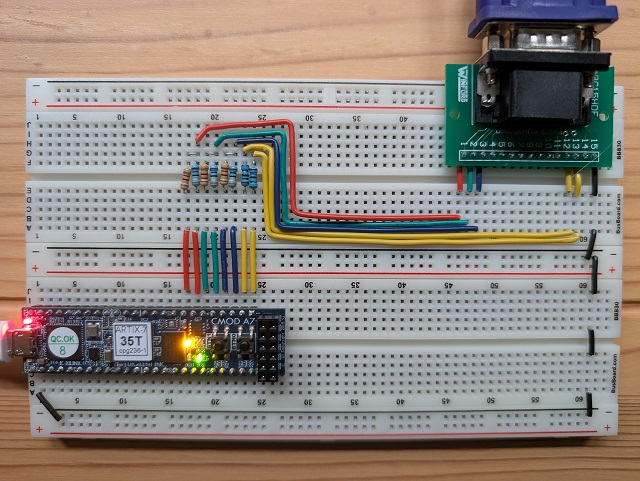
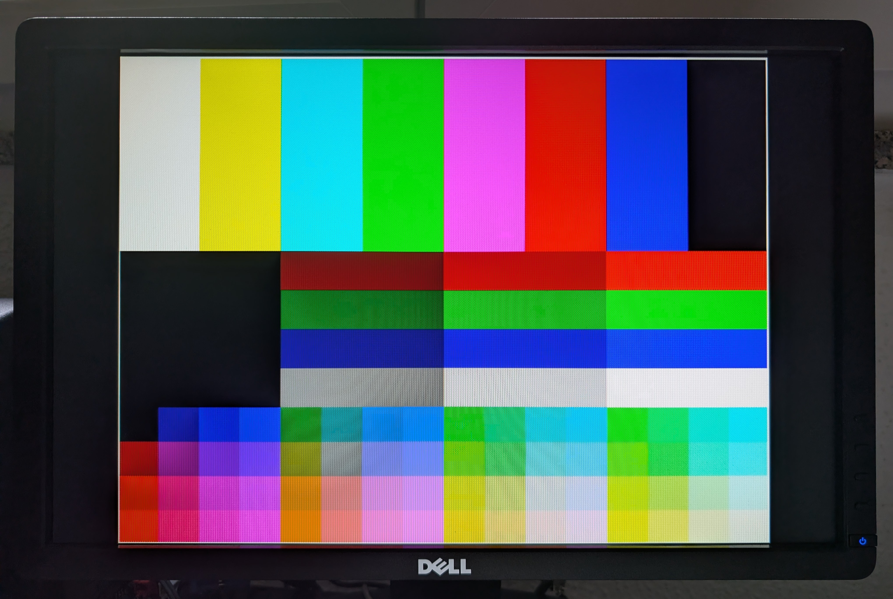

# Cmod A7-35T VGA — mode 13h (320x200, RGB222)

A Verilog VGA controller for the Digilent Cmod A7-35T, driving a VGA breakout
connector on a breadboard. The output is 320x200 in "mode 13h" style, and each
pixel uses the format `0b00rrggbb` (2 bits per colour, 64 colours).

## Features
- VGA 320x200@70Hz 64 colours
- static image produced via combinatorial logic
- Cmod pushbutton 0 resets the logic
- Cmod LED 0 on while the pixel clock is running (MMCM locked); stays on during reset
- Cmod LED 1 blinks once per second; off during reset

## Screenshots





## Graphic test pattern


## Status

| Step | Content | Verified on the monitor |
|------|---------|-------------------------|
| 1 | HSync/VSync 640x400 @ 70 Hz, black screen | yes |
| 2 | Static test image (bars, ramps, 64-colour grid, border) | yes |
| — | RGB LED off, reset with BTN0, boot from flash at power-on | yes |

## Circuit

The Cmod DIP pins connect directly to the FPGA (there are no series resistors
on the board). Each colour channel is a 2-bit weighted-resistor DAC: with the
monitor's 75 Ω load it gives about 0 / 0.24 / 0.48 / 0.70 V.

| Cmod DIP | FPGA pin | Signal     | Resistor | VGA pin |
|----------|----------|------------|----------|---------|
| 1        | M3       | `vga_vs`   | 100 Ω    | 14 VSync |
| 2        | L3       | `vga_hs`   | 100 Ω    | 13 HSync |
| 3        | A16      | `vga_b[1]` | 390 Ω    | 3 Blue (MSB) |
| 4        | K3       | `vga_b[0]` | 820 Ω    | 3 Blue (LSB) |
| 5        | C15      | `vga_g[1]` | 390 Ω    | 2 Green (MSB) |
| 6        | H1       | `vga_g[0]` | 820 Ω    | 2 Green (LSB) |
| 7        | A15      | `vga_r[1]` | 390 Ω    | 1 Red (MSB) |
| 8        | B15      | `vga_r[0]` | 820 Ω    | 1 Red (LSB) |
| 25 (GND) | —        | ground     | —        | 5, 6, 7, 8, 10 |

VGA pins not connected: 4, 9, 11, 12, 15.

## Timing

320x200 is shown as 640x400 at 70 Hz, with each logical pixel doubled into
2x2 physical pixels. Some monitors, like mine, report the mode as 720x400.

| | Visible | Front porch | Sync | Back porch | Total | Polarity |
|---|---|---|---|---|---|---|
| Horizontal (pixels) | 640 | 16 | 96 | 48 | 800 | negative |
| Vertical (lines)    | 400 | 12 | 2  | 35 | 449 | positive |

The pixel clock is 25.2 MHz, derived from the board's 12 MHz with an MMCM
(12 × 63 / 30, VCO at 756 MHz): 31.5 kHz line rate and 70.16 Hz frame rate.

## Files

| File | Content |
|------|---------|
| `rtl/vga_top.v` | Top level: reset, colour/sync pipeline, LEDs |
| `rtl/vga_clk_gen.v` | MMCM 12 → 25.2 MHz |
| `rtl/vga_timing.v` | Counters and HSync/VSync/active signals |
| `rtl/test_pattern.v` | 320x200 test image |
| `cmod_a7_vga.xdc` | Pins, clock and Quad-SPI boot options |
| `sim/tb_vga_timing.v` | Self-checking timing testbench |
| `sim/tb_vga_top.v` | Full-chip "virtual monitor" testbench; writes `frame.ppm` |
| `sim/test_pattern_sim.png` | Reference simulated frame |
| `build.tcl` | Synthesis and implementation; generates `.bit` and `.bin` |
| `program.tcl` | Load over JTAG (volatile) |
| `program_flash.tcl` | Write to the Quad-SPI flash and reboot from it |

Board LEDs: `led[0]` is on when the MMCM is locked, `led[1]` blinks at 1 Hz
by counting frames. The RGB LED is kept off. BTN0 holds the design in reset
while pressed.

## Usage (Vivado 2026.1)

Build (creates `build/vga_top.bit`, `build/vga_top.bin` and the reports):

```
vivado -mode batch -source build.tcl
```

Temporary load over JTAG (lost at power-off):

```
vivado -mode batch -source program.tcl
```

Permanent write to the flash, so the design starts by itself at power-on:

```
vivado -mode batch -source program_flash.tcl
```

The flash on this board is a Macronix MX25L3273F
(`mx25l3273f-spi-x1_x2_x4`), not the Micron N25Q032A named in the manual.
On boards with a different flash, pass the part name as an argument:
`-tclargs <cfgmem part>`.

## Simulation (xsim)

Run from a working directory outside the project, because xsim creates
`xsim.dir` in the current directory. `<repo>` is the path to this project.

Timing:

```
xvlog <repo>/rtl/vga_timing.v <repo>/sim/tb_vga_timing.v
xelab tb_vga_timing -s tb_timing
xsim tb_timing -R
```

Full chip (MMCM included, about 3 minutes):

```
xvlog <repo>/rtl/*.v <repo>/sim/tb_vga_top.v $XILINX_VIVADO/data/verilog/src/glbl.v
xelab tb_vga_top glbl -L unisims_ver -s tb_top
xsim tb_top -R
```

Both testbenches print `PASS` or `FAIL` with the number of errors.

## AI disclaimer

Claude Opus 5.5 was used to generate Verilog code and TCL scripts.
